<!-- ===================================================================== -->
<!--                              HERO BANNER                              -->
<!-- ===================================================================== -->

  <!-- banner is cut into strips so each tile is its own link; keep this on one line -->
  

  

  Exploring the crossroads of <b>machine learning</b>, <b>game AI</b>, and <b>intelligent software systems</b>.

  
  
  
  
  
  
  
   
  

  

 

<!-- ===================================================================== -->
<!--                               ABOUT ME                                -->
<!-- ===================================================================== -->

  

 

<!-- ===================================================================== -->
<!--                        RESEARCH & HIGHLIGHTS                          -->
<!-- ===================================================================== -->

  

 

<!-- ===================================================================== -->
<!--                              TECH STACK                               -->
<!-- ===================================================================== -->

  

 

<!-- ===================================================================== -->
<!--                           GITHUB ANALYTICS                            -->
<!-- ===================================================================== -->

  

 

  
  &nbsp;&nbsp;&nbsp;
  

 

  

 

  

 

  <picture>
    <source media="(prefers-color-scheme: dark)" srcset="https://raw.githubusercontent.com/tashobi02/tashobi02/output/github-snake-dark.svg" />
    <source media="(prefers-color-scheme: light)" srcset="https://raw.githubusercontent.com/tashobi02/tashobi02/output/github-snake.svg" />
    
  </picture>

 

<!-- ===================================================================== -->
<!--                             FOOTER WAVE                               -->
<!-- ===================================================================== -->

  

