 

 

I'm a final-year computer science student at the **Islamic University of Technology (IUT)** in Dhaka, Bangladesh. I like building intelligent systems for games, and I'm most interested in reinforcement-learning agents that adapt to the people they play with. I do my research in IUT's SSL group and keep my fundamentals sharp with competitive programming in C++.

## Focus

| | |
|---|---|
| **Research** | Reinforcement learning for game agents: trace conditioning, model-mediated rewards, and affective signals in games ([trace-lab](https://github.com/tashobi02/trace-lab)) |
| **Building** | [ZetaGo](https://github.com/tashobi02/ZetaGo-Obi), a Go-playing policy network, and hackathon prototypes like [Gale Surface Ops](https://github.com/tashobi02/Gale-Surface-Ops) |
| **Practice** | Competitive programming in C++ ([snippet library](https://github.com/tashobi02/Obi_CP_Snippets)) |
| **Next** | Graduate study at the intersection of AI and games. Open to research internships and collaboration. |

## Selected work

<table>
  <tr>
    <td width="50%" valign="top">
      <b><a href="https://github.com/tashobi02/trace-lab">trace-lab</a></b> 
      Research workspace for trace conditioning and model-mediated rewards in RL: PPO baselines, checkpoint evaluation and trace export on Solid Rally.  
       
    </td>
    <td width="50%" valign="top">
      <b><a href="https://github.com/tashobi02/ZetaGo-Obi">ZetaGo</a></b> 
      A 7×7 Go engine for testing how feature richness and data volume shape a Go-playing policy network.  
       
    </td>
  </tr>
  <tr>
    <td width="50%" valign="top">
      <b><a href="https://github.com/tashobi02/Gale-Surface-Ops">Gale Surface Ops</a></b> · <a href="https://gale-surface-ops.vercel.app">live demo</a> 
      NASA Space Apps Challenge 2026 entry: a habitat-local operations system for a Mars exploration zone, with suit-safe EVA route planning over real terrain and a solar particle event replay.  
      
    </td>
    <td width="50%" valign="top">
      <b><a href="https://github.com/tashobi02/ObiLearnsRL">ObiLearnsRL</a></b> 
      Notes, notebooks and results from the Hugging Face Deep RL course: PPO on LunarLander, tabular Q-learning and Atari DQN.  
       
    </td>
  </tr>
  <tr>
    <td width="50%" valign="top">
      <b><a href="https://github.com/tashobi02/QuantumChess">QuantumChess</a></b> 
      A chess game where luck may matter as much as skill.  
      
    </td>
    <td width="50%" valign="top">
      <b><a href="https://github.com/tashobi02/Obi_CP_Snippets">Obi_CP_Snippets</a></b> 
      Reusable, documented C++ snippets for competitive programming.  
      
    </td>
  </tr>
</table>

More: [IUT_Academics_byObi](https://github.com/tashobi02/IUT_Academics_byObi) (study resources, semesters 3 to 8) · [Smart Campus Energy Optimization](https://github.com/tashobi02/Smart-Campus-Energy-Optimization-Challenge) (BUP CSE Fest hackathon)

## Toolbox

**Languages** &nbsp;

**ML and research** &nbsp;

**Games** &nbsp;

**Systems** &nbsp;

## Off the keyboard

Calisthenics, Soulsborne games, and carrying one of the rarest names in the world.

 

  Based in Dhaka, Bangladesh · Best reached by <a href="mailto:obiditbd@gmail.com">email</a>

