<!-- ===================================================================== -->
<!--                              HERO BANNER                              -->
<!-- ===================================================================== -->

  

  

  Exploring the crossroads of <b>machine learning</b>, <b>game AI</b>, and <b>intelligent software systems</b>.

  
  
  
  
  
  
  
   
  

  

 

<!-- ===================================================================== -->
<!--                               ABOUT ME                                -->
<!-- ===================================================================== -->

## 🚀 About Me

- 🎓 **Computer Science Senior** pursuing a B.Sc. in CSE at **Islamic University of Technology (IUT)**, Dhaka (`Class of 2027`)
- 🏢 Completed **Industrial Training on Applied AI** at **Battery Low Interactive** (`Sep – Oct 2026`)
- 🏋️ Into **fitness and bodybuilding**
- 🏊 Off the keyboard, I enjoy **swimming** and **driving**
- 🎮 Big fan of **Soulsborne games**
- 🔒 Currently building **something I can't show yet**. It's still compiling in the dark, and the reveal is coming soon
- 📫 Reach me at **[obiditbd@gmail.com](mailto:obiditbd@gmail.com)**

> [!TIP]
> **⚡ Fun Fact:** I have one of the rarest names in the world.

 

<!-- ===================================================================== -->
<!--                        RESEARCH & HIGHLIGHTS                          -->
<!-- ===================================================================== -->

## 🔬 Research & Highlights

<table width="100%">
  <tr>
    <td valign="top" width="52%">
      <h3>🧠 Research Interests</h3>
      <ul>
        <li><b>Affective Game Computing</b> — adaptive NPC behaviour, player modelling, and emotion-driven game AI (SSL, IUT)</li>
        <li><b>Continual Model Editing &amp; Unlearning</b> — sequential LLM editing via null-space–projected Cayley rotations that preserve weight geometry</li>
        <li><b>Bengali NLP</b> — hallucination detection and safety evaluation in Bengali LLMs</li>
      </ul>
    </td>
    <td valign="top" width="48%">
      <h3>🏆 Achievements</h3>
      <ul>
        <li><b>Finalist (Top 20 / 400+)</b> — <i>IUT Agentic AI Hackathon</i> (built AgriSense AI)</li>
        <li><b>4th Place (50+ teams)</b> — <i>HerWILL &times; UAP Safe Social Media Datathon 2026</i> (Macro F1 = 0.748)</li>
        <li><b>9th Place</b> — <i>Bengali LLM Hallucination-Detection Datathon</i> (Team Lead, F1 = 0.910)</li>
      </ul>
    </td>
  </tr>
</table>

 

<!-- ===================================================================== -->
<!--                              TECH STACK                               -->
<!-- ===================================================================== -->

## 🛠️ Tech Stack

  

 

<!-- ===================================================================== -->
<!--                           GITHUB ANALYTICS                            -->
<!-- ===================================================================== -->

## 📊 GitHub Analytics

  
  &nbsp;
  

  

  

  <picture>
    <source media="(prefers-color-scheme: dark)" srcset="https://raw.githubusercontent.com/tashobi02/tashobi02/output/github-snake-dark.svg" />
    <source media="(prefers-color-scheme: light)" srcset="https://raw.githubusercontent.com/tashobi02/tashobi02/output/github-snake.svg" />
    
  </picture>

 

<!-- ===================================================================== -->
<!--                             FOOTER WAVE                               -->
<!-- ===================================================================== -->

  

